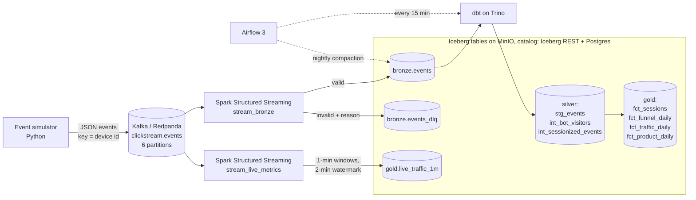

# Clickstream Lakehouse

A real-time e-commerce clickstream pipeline built end to end on an open-source modern data stack, running locally with Docker.
It goes from simulated user clicks to tested, business-ready tables. The design choices are the ones product companies make at scale: Kafka, Spark Structured Streaming, Apache Iceberg, dbt, Trino and Airflow.



## What it does

| Layer | What happens | Tech |
|---|---|---|
| **Generate** | Realistic shopping sessions (home → search → product → cart → checkout → purchase) with real-world mess: ~2% duplicates, ~3% late events (up to 90 min), malformed JSON, bots, cookie resets, schema drift | Python, `confluent-kafka` |
| **Ingest** | Events are keyed by device id, so each device's clicks stay ordered within a partition. Idempotent producer with `acks=all`. | Redpanda (Kafka API) |
| **Bronze** | Streaming job validates every event against a data contract. Valid events go to `bronze.events`, invalid ones to a dead-letter table with an `error_reason`. Exactly-once delivery (checkpoints + atomic Iceberg commits). | Spark 3.5 Structured Streaming, Iceberg |
| **Speed layer** | Per-minute events, approximate unique users and revenue. Duplicates are dropped within the watermark; late data is bounded by a 2-minute watermark. | Spark, RocksDB state store |
| **Silver** | Deduplication on `event_id`, bot detection from two signals (declared + behavioural), sessionization using the gaps-and-islands technique with a 30-minute inactivity timeout | dbt on Trino |
| **Gold** | Sessions, conversion funnel, channel/campaign performance, product performance | dbt on Trino |
| **Quality** | Grain tests, a cross-table revenue reconciliation test, DLQ-rate check, device-consistency check, source freshness SLA, unit tests for simulator and Spark | dbt tests, pytest |
| **Orchestration** | dbt every 15 min (each model is its own Airflow task via Cosmos). Nightly Iceberg compaction, snapshot expiry and orphan-file cleanup. | Airflow 3 |

## Results (local run)

- **Exactly-once verified:** `count(*) = count(distinct partition, offset)` in bronze, before and after killing the Spark job (243,540 = 243,540)
- **DLQ catches every injected failure type:** `bad_timestamp`, `unknown_event_type`, `missing_identity`, `malformed_json`
- **Sessionization recovers the simulator's sessions** without ever seeing session labels (~2,890 detected vs ~2,910 simulated; the difference is devices returning within 30 min, which is correct behaviour)
- **Revenue reconciles to the rupee** across every gold table (enforced by a dbt test)

## Quick start

**Requirements:** Docker Desktop (8–10 GB RAM allocated), [uv](https://docs.astral.sh/uv/), macOS or Linux.

```bash
# 1. Python env (simulator, dbt, tests)
uv sync

# 2. Start the platform: Kafka, MinIO, Iceberg catalog, Trino, Spark streaming, Airflow
docker compose up -d --build

# 3. Stream events (Ctrl+C to stop)
uv run python simulator/producer.py --bootstrap localhost:19092 --rate 5

# 4. Build silver + gold manually (Airflow also does this every 15 min)
uv run dbt build --project-dir dbt --profiles-dir dbt
```

| UI | URL |
|---|---|
| Kafka console (Redpanda) | http://localhost:8088 |
| MinIO (object storage) | http://localhost:9001 (`admin` / `password`) |
| Trino | http://localhost:8080 |
| Spark UI (bronze / live metrics) | http://localhost:4040 / http://localhost:4041 |
| Airflow | http://localhost:8090 |
| dbt docs (lineage) | `uv run dbt docs generate --project-dir dbt --profiles-dir dbt && uv run dbt docs serve --project-dir dbt --profiles-dir dbt --port 8085` |

### Try some queries
```bash
docker compose exec trino trino
```
```sql
-- Funnel by device
SELECT device, sessions, sessions_viewed_product, sessions_added_to_cart,
       sessions_started_checkout, sessions_converted, conversion_rate
FROM lake.gold.fct_funnel_daily ORDER BY sessions DESC;

-- Which marketing channel brings buyers, not just clicks?
SELECT channel, campaign, sum(sessions) AS sessions, sum(revenue) AS revenue
FROM lake.gold.fct_traffic_daily GROUP BY 1, 2 ORDER BY revenue DESC;

-- What's happening right now
SELECT * FROM lake.gold.live_traffic_1m ORDER BY window_start DESC LIMIT 20;

-- Iceberg time travel: every streaming commit is a snapshot
SELECT snapshot_id, committed_at, operation FROM lake.bronze."events$snapshots" ORDER BY committed_at DESC LIMIT 5;
```

### Stop / resume
```bash
docker compose stop      # keeps all data (Kafka, tables, checkpoints)
docker compose start     # Spark resumes from its checkpoints: nothing lost, nothing duplicated
# docker compose down -v # full reset: deletes ALL data
```

## Project structure

```
clickstream-lakehouse/
├── docker-compose.yml          # the whole platform
├── simulator/
│   ├── events.py               # session generator + chaos (dupes, late, malformed, bots, drift)
│   ├── producer.py             # dry run or real-time stream to Kafka
│   └── tests/                  # pytest
├── spark/
│   ├── Dockerfile              # Spark 3.5 + Iceberg + Kafka jars
│   ├── conf/spark-defaults.conf
│   ├── clickstream/            # schema (data contract), pure transforms, io helpers
│   ├── jobs/                   # stream_bronze.py, stream_live_metrics.py
│   └── tests/                  # pytest on the transforms (no Kafka needed)
├── trino/catalog/lake.properties
├── dbt/
│   ├── models/staging/         # stg_events (dedup)
│   ├── models/intermediate/    # int_bot_visitors, int_sessionized_events
│   ├── models/marts/           # fct_sessions, fct_funnel_daily, fct_traffic_daily, fct_product_daily
│   ├── tests/                  # reconciliation, DLQ rate, device consistency, future events
│   └── macros/
└── airflow/
    ├── Dockerfile              # Airflow 3 + Cosmos + dbt (separate venv) + Trino client
    └── dags/                   # clickstream_dbt, iceberg_maintenance
```

## Design decisions

| Decision | Why | Trade-off |
|---|---|---|
| **Kafka key = device id** | Kafka only orders messages within a partition, so keying by device keeps each device's clicks in sequence | Hot keys (e.g. bots) can skew partitions |
| **Keep duplicates in bronze** | Bronze is the replayable source of truth; dedup logic can change without losing data | Bronze is ~2% larger |
| **Two streaming queries, two checkpoints** (bronze + DLQ) | Each sink is exactly-once on its own; one `foreachBatch` writing both tables could not commit them atomically | The topic is read twice |
| **Dead-letter table with `error_reason`** | Bad events neither crash the pipeline nor disappear silently; they're countable and alertable | Needs its own monitoring (DLQ-rate test) |
| **2-minute watermark on live metrics** | Bounded state and fresh numbers | Events later than 2 min are dropped from live metrics only. They still land in bronze, and the batch layer (dbt) corrects the totals. |
| **Event time (`event_ts`) for windows and sessions, ingestion time (`ingested_at`) for freshness** | Late events land in the minute they happened, and freshness reflects pipeline health | Two timestamps to reason about |
| **Bot detection from two signals** | Honest crawlers declare themselves; bad bots fake their user agent but can't fake human click speed | Threshold tuning |
| **dbt runs on Trino, not Spark** | SQL-first modelling, tests and docs; compute is pushed down to the engine | Trino isn't built for very long-running batch jobs |
| **Iceberg REST catalog backed by Postgres** | Engine-agnostic: Spark writes, Trino reads the same tables | One more service to run |
| **Nightly compaction** | 30-second streaming commits create many small files, which slow queries down | Compaction can conflict with streaming commits, so the task retries |

## Problems hit (and fixed) while building

1. **MinIO images were removed from Docker Hub** (Sept 2026). Switched to a maintained build of the same MinIO server, and the AWS CLI for bucket setup. Nothing else changed because everything talks to the S3 API.
2. **Spark crash-looped: "Cannot write incompatible dataset"**. The bronze DataFrame's column order didn't match the Iceberg table, and Iceberg checks it on write. Fixed the transform and added a regression unit test that compares output columns to the table DDL.
3. **`SQLITE_BUSY: database is locked`** once two streaming jobs committed concurrently. The REST catalog's SQLite backend allows only one writer. Moved the catalog to Postgres, then reset the lakehouse and rebuilt it by replaying 7 days of retained Kafka events. Exactly-once checks still passed.

## Testing

```bash
uv run pytest simulator/tests -q                                            # simulator
docker compose run --rm --no-deps spark-bronze python3 -m pytest -q tests  # Spark transforms
uv run dbt build --project-dir dbt --profiles-dir dbt                       # models + data tests
uv run dbt source freshness --project-dir dbt --profiles-dir dbt            # freshness SLA
```

## Roadmap

- [ ] Governance: Trino access rules, PII masking, GDPR delete across all layers (incl. snapshot expiry)
- [ ] Monitoring: Prometheus + Grafana (consumer lag, batch duration, freshness, DLQ %), alerting
- [ ] Lineage: OpenLineage + Marquez across Spark, dbt and Airflow
- [ ] Superset dashboard on the gold layer
- [ ] CI with GitHub Actions (lint, unit tests, dbt build)
- [ ] CDC orders stream (Postgres → Debezium) joined with clicks
- [ ] Write-Audit-Publish with Iceberg branches
